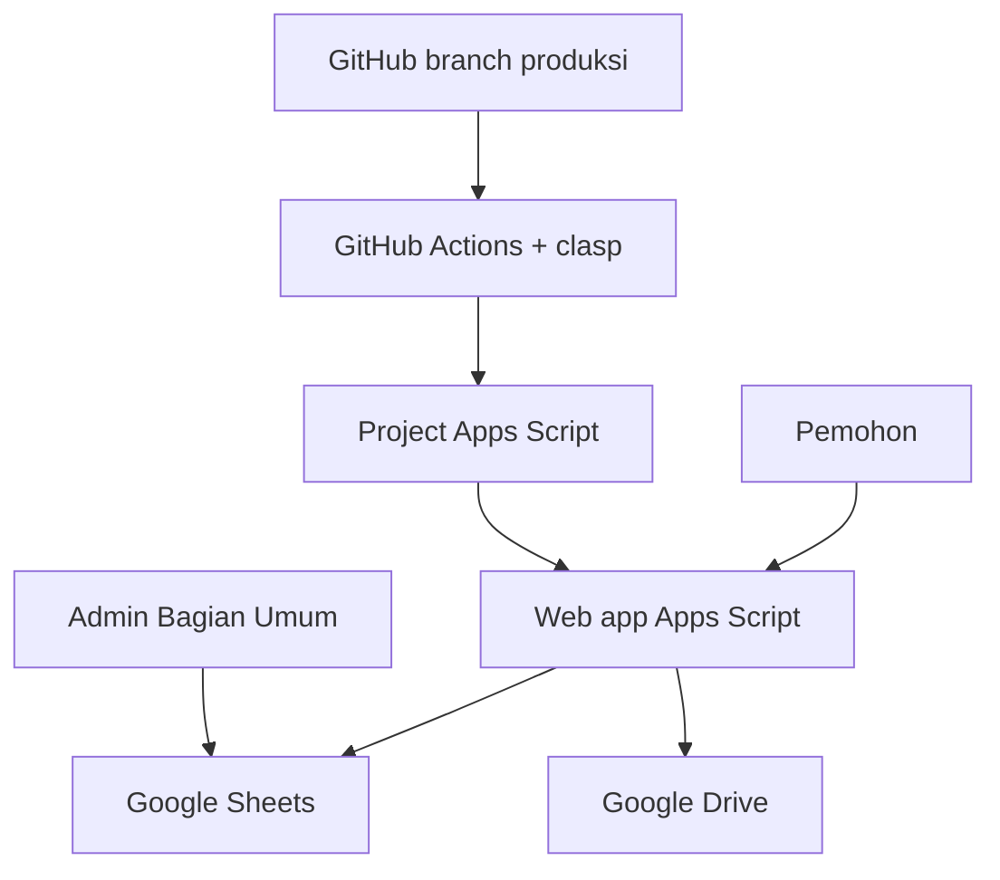
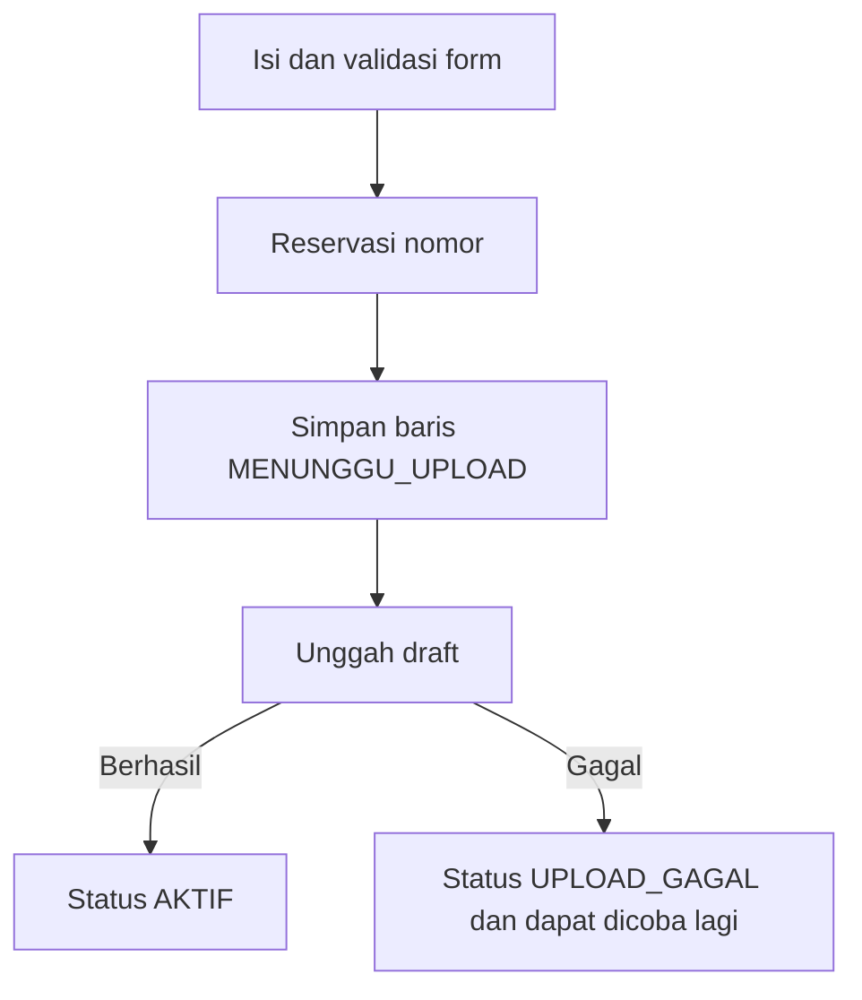
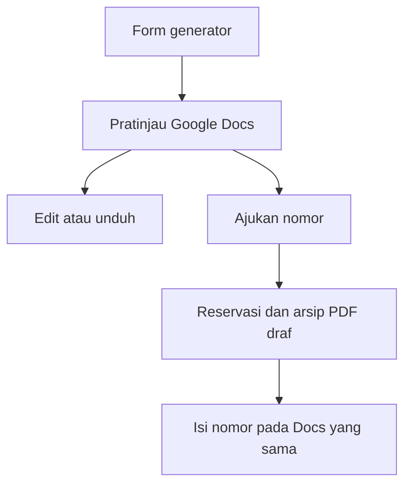

# Handover Project SIDDIQ — Sistem Penomoran Surat Otomatis

Dokumen induk Bagian Umum UIN Sunan Ampel Surabaya. Baseline serah terima **9 November 2026 (WIB)**, sampai sprint pencarian personel dan perapian tabel Nota Dinas ST/SPD.

Untuk pindah chat, gunakan prompt siap salin di **§32**. Untuk melanjutkan pengembangan, cek baseline di bawah dan runbook rilis di **§19–20 dan §31**. Riwayat sprint ada di **§25**. Fitur final, generator Docs, dan pembaruan personel dijelaskan di **§28–30**.

## 1. Ringkasan status

| Item | Baseline terverifikasi |
|---|---|
| Zona waktu | `Asia/Jakarta` |
| Repository | [fathonydnm-byte/sistem-penomoran-otomatis](https://github.com/fathonydnm-byte/sistem-penomoran-otomatis) |
| Branch produksi dan default | `claude/audit-surat-dinas-system-p9saof` |
| Versi web app live | **v46** dari `58ee753100e2968f1de3d539b01777605567c8fa` |
| Bukti deployment live | [Actions run 42534242361](https://github.com/fathonydnm-byte/sistem-penomoran-otomatis/actions/runs/42534242361), push 18 file dan deploy v46 berhasil. Versi dan SHA dikonfirmasi di Manage deployments |
| Branch staging aktif | `feature/final-upload-chunks-20261104` |
| Versi staging | **v24** dari `2bcc0050f2e16fccae2ab48914c006d3b05e2839` |
| Bukti deployment staging | [Actions run 42536975296](https://github.com/fathonydnm-byte/sistem-penomoran-otomatis/actions/runs/42536975296), sembilan suite dan deploy staging lulus |
| Sprint terakhir | Pencarian `Master_Pegawai`, pengisian otomatis yang bisa diedit, NIP personel opsional, tabel Docs lima kolom, perbaikan batas panjang jabatan |
| Verifikasi terbaru | Sembilan suite lokal lulus. Template sumber ST/SPD dibaca ulang. Uji live v46 menghasilkan Google Docs tanpa menerbitkan nomor |

Pada waktu serah terima, perbedaan antara commit rilis dan ujung branch produksi hanya dokumentasi dan bukti pengujian. Kode live dapat ditelusuri ke log rilis dan SHA di atas. Seluruh 18 file runtime di branch staging dan produksi cocok sebelum transformasi khusus staging. Google Docs sumber, isi Sheets, Script Properties, izin, dan trigger dikelola di Workspace.

## 2. Tujuan aplikasi

Aplikasi menerbitkan nomor surat otomatis bagi pemohon Kantor Pusat UIN Sunan Ampel Surabaya, menyimpan metadata permohonan di Google Sheets, serta mengarsipkan draft surat ke Google Drive.

Jenis nomor yang dikelola:

1. `Surat Dinas`
2. `Nota Dinas`
3. `SK/SE` — SK dan SE menggunakan satu counter bersama

Sistem mendukung:

- permintaan nomor untuk tanggal hari ini;
- permintaan nomor tanggal sebelumnya dari slot reservasi;
- pengajuan individual;
- pengajuan massal dengan gerbang akses khusus;
- unggah draft dengan retry dan pemulihan;
- pencatatan audit permintaan serta perubahan admin;
- migrasi slot lama yang ditandai `Slot Kosong`;
- arsip tahunan otomatis;
- tautan template resmi Viewer dan rekomendasi kode Surat Dinas/Nota Dinas;
- pelengkapan PDF final, monitoring admin, ekspor dan unggah resumable;
- generator Google Docs dari tujuh tipe template, pratinjau, dan pengajuan nomor dari draf yang sama;
- pencarian personel dari `Master_Pegawai` pada permohonan ST/SPD.

## 3. Lokasi dan identitas sistem

| Komponen | Identitas |
|---|---|
| GitHub | <https://github.com/fathonydnm-byte/sistem-penomoran-otomatis> |
| Apps Script project ID | `1a105dbVLfTVRwogvyvA4TIk5QmZnBLmUVnk1SoUxCBU_KEHmg28tv29_` |
| Spreadsheet ID | `1C-u9r4440ZDprkcZMSnjbjki-FoVEF99DmwJmUZpjXs` |
| Folder Drive induk | `1KF7Ak9xReV8MvLmtzMd855tihVi0XBlB` |
| Deployment ID | `AKfycbz4i88ZxnpnlvDV2bgBH3eebT2m7tAHMRo_vCJOurG1BF6HTzT28dXXss3A97gMp-DH` |
| URL web app | <https://script.google.com/macros/s/AKfycbz4i88ZxnpnlvDV2bgBH3eebT2m7tAHMRo_vCJOurG1BF6HTzT28dXXss3A97gMp-DH/exec> |
| Akun admin/deployer | `bag.umum@uinsa.ac.id` |

ID di atas bukan kredensial rahasia, tetapi perubahan terhadap project, spreadsheet, folder, atau deployment harus dilakukan secara terkontrol. Jangan menaruh token OAuth, isi `.clasprc.json`, kode akses massal, atau secret GitHub ke repository.

## 4. Arsitektur



Google Sheets menyimpan register, konfigurasi, dan master. Drive menyimpan draft, template dan PDF final. Workbook privat menyimpan ledger final dan status proses generator. Apps Script menangani validasi, nomor, lock, unggah, render Google Docs, menu admin, trigger, dan halaman pengguna. GitHub menyimpan source, workflow, dan bukti rilis.

## 5. Struktur source code

| Berkas | Tanggung jawab utama |
|---|---|
| `Code.js` | Konfigurasi inti, web app, permintaan individual, counter, upload, validasi, spreadsheet dan Drive |
| `Index.html` | Seluruh antarmuka pengguna, form normal/backdate/massal, loading dan progress upload |
| `Bulk.js` | Autentikasi mode massal, reservasi rentang nomor dan utilitas massal |
| `Reservations.js` | Reservasi harian, hari kerja/libur, nomor mundur, migrasi slot lama dan log permintaan |
| `Admin.js` | Edit, pembatalan, token admin dan audit perubahan |
| `Archive.js` | Arsip tahunan manual/otomatis serta notifikasi |
| `EditDialog.html` | Dialog edit baris terpilih dari Google Sheets |
| `LetterCodes.html` | Rekomendasi format kode dan master klasifikasi dari Excel |
| `FinalLetters.js`, `FinalLettersUI.html` | Riwayat publik, validasi dan ledger final, monitoring, admin, ekspor |
| `FinalStorage.js` | Bootstrap cadangan dan penyimpanan privat |
| `FinalUpload.js`, `FinalUploadClient.html` | Sesi unggah final, paket, progres, retry dan commit |
| `LetterDrafts.js`, `LetterDraftsUI.html` | Form generator, data master, render Google Docs, pratinjau, pengajuan nomor, pencarian personel |
| `LetterDraftClassification.js` | Daftar klasifikasi untuk generator draf |
| `LetterDraftJobs.js` | Penyimpanan status proses draf dan penomoran pada ledger privat |
| `appsscript.json` | Manifest Apps Script, runtime, timezone dan akses web app |
| `.github/workflows/clasp-push.yml` | Sinkronisasi GitHub ke Apps Script dan deployment bersyarat |
| `.claspignore` | Mencegah dokumen, tes dan workflow terkirim sebagai source Apps Script |
| `tests/*.cjs` | Sembilan suite regresi produksi. Rincian di §23 |
| `docs/reservasi-harian.md` | Dokumen implementasi khusus fitur reservasi |

## 6. Model nomor dan counter

Counter disimpan di sheet `PENGATURAN`.

| Jenis | Kunci counter | Folder | Kode file | Dari/Kepada |
|---|---|---|---|---|
| Surat Dinas | `NEXT_SURAT_DINAS` | `Surat Dinas` | `SD` | Wajib |
| Nota Dinas | `NEXT_NOTA_DINAS` | `Nota Dinas` | `ND` | Wajib |
| SK/SE | `NEXT_SK_SE` | `SK-SE` | `SK-SE` | Tidak digunakan |

Snapshot counter saat verifikasi 25 September 2026:

| Kunci | Nilai |
|---|---:|
| `COUNTER_YEAR` | 2026 |
| `NEXT_SURAT_DINAS` | 2101 |
| `NEXT_NOTA_DINAS` | 1045 |
| `NEXT_SK_SE` | 952 |

Nilai di atas adalah snapshot, bukan angka statis. Counter akan terus berubah saat nomor diterbitkan. Pada pergantian tahun, counter tahun baru diinisialisasi kembali dari 1 oleh logika aplikasi.

Nomor hanya berupa bilangan untuk setiap kategori dan tahun. Nomor yang sudah dialokasikan tidak boleh dipakai ulang, termasuk jika upload draft gagal atau permintaan dibatalkan.

## 7. Alur permintaan individual



Nomor diterbitkan sebelum file diunggah. Keputusan ini disengaja agar sesi upload yang lambat tidak memegang lock counter. Konsekuensinya, kegagalan upload tidak membatalkan atau mengembalikan nomor.

Urutan server:

1. Terima dan normalisasi data form.
2. Validasi jenis surat, unit, pemohon, perihal, routing, dan token pengiriman.
3. Ambil `ScriptLock`.
4. Pastikan reservasi harian hari tersebut sudah dibuat.
5. Reset counter bila tahun berubah.
6. Alokasikan nomor dan simpan baris `MENUNGGU_UPLOAD`.
7. Lepaskan lock.
8. Upload file lewat panggilan terpisah.
9. Simpan link/file ID dan ubah status menjadi `AKTIF`.

Token pengiriman membuat proses reservasi idempoten: pengiriman ulang payload yang sama mengembalikan identitas permintaan yang sama, bukan nomor baru.

## 8. Upload draft dan indikator progress

Ketentuan saat ini:

- ukuran maksimal: 10 MB;
- ekstensi: PDF, DOC, DOCX, XLS, XLSX;
- mode individual mencoba upload maksimal 3 kali;
- mode massal mencoba upload maksimal 4 kali per item;
- status `MENGUNGGAH` yang macet dapat dipulihkan setelah 15 menit;
- file orphan yang sudah berhasil masuk Drive dapat dipakai kembali saat penyelarasan status;
- antarmuka menampilkan overlay/progress sehingga pengguna mengetahui proses masih berjalan;
- peringatan `beforeunload` mencegah tab tidak sengaja ditutup saat upload aktif.

Pola nama file:

```text
<tahun>_<kode-jenis>_<nomor>_<nama-pemohon>_<nama-file-asli>
```

Struktur folder:

```text
Folder Induk
└── <Tahun>
    ├── Surat Dinas
    ├── Nota Dinas
    └── SK-SE
```

## 9. Status permintaan

| Status | Makna |
|---|---|
| `SLOT_TERSEDIA` | Nomor dicadangkan dan belum diambil pemohon |
| `MENUNGGU_UPLOAD` | Nomor sudah melekat pada permintaan; file belum aktif |
| `MENGUNGGAH` | Server sedang memproses upload |
| `AKTIF` | Nomor dan draft sudah tersimpan |
| `UPLOAD_GAGAL` | Nomor tetap dipakai; file perlu dicoba lagi |
| `GAGAL` | Kegagalan proses yang dicatat |
| `DIBATALKAN` | Permintaan dibatalkan tanpa mengembalikan nomor |

## 10. Mode permintaan

| Mode | Kegunaan |
|---|---|
| `HARI_INI` | Permintaan individual dari counter berjalan |
| `MUNDUR` | Mengambil slot reservasi berdasarkan tanggal dan jenis |
| `MASSAL` | Reservasi beberapa nomor berurutan untuk data bersama |
| `RESERVASI` | Placeholder reservasi, baik hasil alokasi harian maupun migrasi slot lama; asalnya dibedakan pada ledger |

Nama mode aktual mengikuti nilai yang ditulis source. Saat menambah mode baru, perbarui dokumentasi, validasi, audit log, dan pengujian.

## 11. Reservasi nomor harian

Tujuan fitur ini adalah menyediakan nomor untuk permintaan surat bertanggal sebelumnya tanpa mengubah tanggal surat menjadi tanggal pengajuan aktual.

Snapshot konfigurasi pada audit September 2026. Cek nilai terkini sebelum mengubah setting:

| Parameter | Nilai |
|---|---|
| Aktif | Ya |
| Mulai tanggal | 19 September 2026 |
| Surat Dinas | 4 slot per hari kerja |
| Nota Dinas | 4 slot per hari kerja |
| SK/SE | 4 slot per hari kerja |
| Kalender terverifikasi | 2026, 2027 |

Aturan penting:

- slot dibuat hanya untuk hari kerja;
- Sabtu, Minggu, dan tanggal pada `HARI_LIBUR` tidak mendapat slot;
- cuti bersama tetap dianggap hari kerja kecuali sengaja dimasukkan ke `HARI_LIBUR`;
- jumlah slot dapat diubah admin antara 0–100 per kategori;
- tidak ada pembuatan slot retroaktif otomatis sebelum tanggal aktivasi;
- trigger berjalan setiap menit agar segera menangkap pergantian tanggal WIB;
- eksekusi idempoten sehingga pemanggilan berulang tidak menggandakan slot;
- rencana alokasi pending disimpan pada Script Properties supaya proses yang terputus dapat dilanjutkan;
- counter dinaikkan lebih dahulu sebelum placeholder dimaterialisasi untuk mencegah nomor ganda.

Contoh: bila 4 slot hari ini adalah 41–44, permintaan reguler berikutnya dimulai dari 45. Jika nomor aktual terakhir hari ini 60, reservasi besok dimulai 61–64.

## 12. Permintaan nomor tanggal sebelumnya

Alur pengguna:

1. Buka panel `Permintaan Nomor Tanggal Sebelumnya` pada halaman yang sama.
2. Pilih jenis surat.
3. Pilih tanggal sebelum hari ini.
4. Klik `Cek Ketersediaan`.
5. Lengkapi data permohonan.
6. Sistem mengambil nomor terkecil yang masih tersedia untuk kombinasi tanggal + jenis.

Aturan:

- tidak memerlukan persetujuan admin;
- terbuka untuk seluruh pemohon;
- hanya tanggal sebelum hari ini yang diperbolehkan;
- nomor harus berasal dari slot persis pada tanggal dan jenis yang dipilih;
- slot tetap tersedia tanpa batas waktu selama belum diambil;
- jika habis, pengguna diminta memilih tanggal lain atau menghubungi admin;
- `Tanggal Surat` tetap tanggal mundur yang dipilih;
- `Waktu Pengajuan Aktual` tetap waktu pengguna benar-benar mengajukan;
- tanggal di halaman hasil ditampilkan `dd/MM/yyyy`;
- nomor yang sudah diambil tidak kembali ke pool meskipun upload gagal.

Pemisahan `Tanggal Surat` dan `Waktu Pengajuan Aktual` wajib dipertahankan. Menggabungkan keduanya akan membuat nomor lama tampak seolah diterbitkan pada hari pengajuan.

## 13. Migrasi slot lama `Slot Kosong`

Perihal `Slot Kosong` adalah penanda otoritatif untuk data lama. Sistem pemetaan:

1. Memindai semua baris `PERMINTAAN` dengan perihal `Slot Kosong` secara case-insensitive.
2. Menampilkan kandidat pada `TINJAU_SLOT_LAMA`.
3. Admin meninjau/menyetujui.
4. Sistem membuat backup sebelum impor.
5. Slot yang disetujui dimasukkan ke indeks reservasi dan tetap merujuk tanggal/jenis/nomor asal.

Migrasi awal pada 19 September 2026 memetakan 278 slot:

| Jenis | Jumlah |
|---|---:|
| Surat Dinas | 94 |
| Nota Dinas | 101 |
| SK/SE | 83 |
| Total | 278 |

Rentang tanggal slot lama: 31 Juli 2026 sampai 17 September 2026. Backup historis berada di sheet tersembunyi `CADANGAN_PERMINTAAN_SEBELUM_IMPOR_SLOT_20260919`.

Jangan menghapus backup atau sheet tinjauan tanpa salinan eksternal dan persetujuan admin.

## 14. Mode massal

Mode massal disembunyikan dari alur utama agar pengguna umum tidak bingung. Akses memakai kode yang disimpan pada `PENGATURAN`.

Keamanan dan perilaku:

- kode diverifikasi di server dengan perbandingan constant-time;
- kode yang benar menghasilkan token HMAC berlaku 2 jam;
- batas default/live: 100 item per batch;
- nomor dialokasikan sebagai rentang berurutan dalam satu lock;
- semua baris ditulis dalam satu operasi batch;
- upload dilakukan satu per satu agar stabil terhadap batas Apps Script/browser;
- setiap item memiliki status, spinner, dan tombol coba lagi;
- item yang gagal upload tidak membatalkan item lain dan nomornya tetap terpakai.

Kode akses massal sengaja tidak dicatat di dokumen ini. Admin dapat menggantinya dari `PENGATURAN` tanpa perubahan source code.

## 15. Skema Google Sheets

### 15.1 `PERMINTAAN`

| Kolom | Header | Fungsi |
|---:|---|---|
| A | Tanggal dan Waktu Surat | Waktu/tanggal surat historis; kompatibilitas data lama |
| B | Nomor Surat | Nomor numerik |
| C | Jenis Surat | Surat Dinas, Nota Dinas, atau SK/SE |
| D | Perihal | Detail surat; `Slot Kosong` untuk placeholder lama |
| E | Dari | Pejabat/unit pengirim |
| F | Kepada | Tujuan surat |
| G | Nama Pemohon | Nama pengaju |
| H | Unit Kerja | Unit pengaju |
| I | Email Terdeteksi | Opsional; dapat kosong pada akses anonim |
| J | Link Alih Media | URL draft di Drive |
| K | Status | Status siklus permintaan |
| L | ID Permintaan | UUID atau ID slot unik |
| M | Tahun | Tahun nomor |
| N | Nama File Asli | Nama file sebelum dinormalisasi |
| O | ID File Drive | ID file hasil upload |
| P | Token Pengiriman | Idempotency token |
| Q | Kunci Pengguna Sementara | Pengikat sesi/pengguna sementara |
| R | Diperbarui Pada | Waktu perubahan terakhir |
| S | Tanggal Surat | Tanggal surat khusus, format `dd/MM/yyyy` |
| T | Mode Permintaan | Hari ini, mundur, massal, reservasi, atau migrasi |
| U | Waktu Pengajuan Aktual | Timestamp pengajuan sebenarnya |

`PERMINTAAN` adalah sumber kebenaran untuk ketersediaan dan penggunaan nomor.

### 15.2 `PENGATURAN`

Kunci utama:

- `COUNTER_YEAR`
- `NEXT_SURAT_DINAS`
- `NEXT_NOTA_DINAS`
- `NEXT_SK_SE`
- `ROOT_FOLDER_ID`
- `TIMEZONE`
- `MAX_FILE_SIZE_MB`
- `ALLOWED_EXTENSIONS`
- `ADMIN_EMAIL`
- `BULK_ACCESS_CODE`
- `BULK_MAX_ITEMS`
- `SCHEMA_VERSION`

Jangan mengubah counter saat permohonan sedang aktif. Catat nilai lama, alasan, waktu, dan nilai baru jika koreksi manual benar-benar diperlukan.

### 15.3 `KONFIGURASI_RESERVASI`

| Kolom | Isi |
|---|---|
| A | Kunci |
| B | Nilai |
| C | Keterangan |

Kunci: `AKTIF`, `MULAI_TANGGAL`, tiga nama jenis surat, dan `TAHUN_KALENDER_DIVERIFIKASI`.

### 15.4 `HARI_LIBUR`

| Kolom | Isi |
|---|---|
| A | Tanggal |
| B | Keterangan Libur Nasional |

Sheet ini harus diisi dan tahun harus ditandai terverifikasi sebelum alokasi tahun bersangkutan diizinkan.

### 15.5 `RESERVASI_NOMOR`

Header:

1. ID Slot
2. Tanggal Surat
3. Jenis Surat
4. Nomor
5. Asal
6. Dibuat Pada
7. ID Permintaan Pemakai
8. Diambil Pada
9. File Placeholder Lama

Sheet ini adalah ledger/audit slot yang tahan lama; status pemakaian tetap dikonfirmasi terhadap `PERMINTAAN`.

### 15.6 `LOG_PERMINTAAN`

Mencatat timestamp kejadian, waktu pengajuan, tanggal surat, jenis, nomor, perihal, dari, kepada, pemohon, unit, email opsional, ID permintaan, mode, dan kejadian.

### 15.7 `LOG_PERUBAHAN`

Mencatat timestamp, ID permintaan, nomor, aksi, kolom, nilai lama, nilai baru, alasan, dan email admin.

### 15.8 Sheet tersembunyi

- `RESERVASI_NOMOR`
- `LOG_PERMINTAAN`
- `HARI_LIBUR`
- `TINJAU_SLOT_LAMA`
- `CADANGAN_PERMINTAAN_SEBELUM_IMPOR_SLOT_20260919`

Sheet dapat ditampilkan saat audit, tetapi jangan diubah langsung tanpa memahami relasinya dengan `PERMINTAAN`.

## 16. Menu admin Google Sheets

Menu `Administrasi Nomor Surat` menyediakan:

1. Edit Permintaan Terpilih
2. Batalkan Permintaan Terpilih
3. Arsipkan Data Tahun Lalu
4. Buka Pengaturan Counter
5. Siapkan Reservasi Harian
6. Aktifkan Reservasi Harian
7. Tinjau Slot Kosong Lama
8. Setujui Semua Slot Lama Siap
9. Impor Slot Lama yang Disetujui
10. Instal / Perbaiki Sistem

Edit admin memakai token HMAC yang terikat pada baris, ID permintaan, dan admin. Perubahan menyimpan nilai lama, nilai baru, alasan, serta email admin. Semua record dapat diedit, termasuk permintaan mundur dan placeholder reservasi. Bila tanggal/jenis/nomor record reservasi berubah, editor menyelaraskan `PERMINTAAN` dan `RESERVASI_NOMOR` di bawah script lock yang sama. ID internal, status, mode, token, dan waktu pengajuan aktual tidak diedit dari dialog umum.

Pembatalan mengubah status tetapi tidak menghapus baris dan tidak mendaur ulang nomor.

## 17. Concurrency, integritas, dan keamanan data

Mekanisme yang harus dipertahankan:

- `LockService.getScriptLock()` untuk semua penulis counter;
- durasi lock sesingkat mungkin;
- upload file dilakukan setelah lock dilepas;
- idempotency token mencegah double submit;
- penyimpanan rencana reservasi pending untuk recovery;
- input teks dibersihkan untuk mencegah formula injection Sheets;
- validasi ulang di server, bukan hanya di browser;
- nomor tidak pernah didaur ulang otomatis;
- `PERMINTAAN` sebagai sumber kebenaran;
- log audit append-only sebisa mungkin.

Web app dijalankan sebagai akun deployer dan dapat diakses `ANYONE_ANONYMOUS`. Karena itu, `Session.getActiveUser().getEmail()` dapat kosong. Email adalah metadata opsional dan tidak boleh dijadikan satu-satunya kontrol keamanan form publik.

## 18. Arsip tahunan

Trigger arsip dipasang bulanan pada tanggal 2 sekitar pukul 02.00 WIB. Apps Script tidak menyediakan trigger tahunan langsung; proses bulanan bersifat idempoten dan hanya memindahkan data tahun sebelumnya.

Tujuan:

- menjaga `PERMINTAAN` dan `LOG_PERUBAHAN` tetap ringan;
- memindahkan data selesai ke `ARSIP_<NAMA_SHEET>_<TAHUN>`;
- mempertahankan data tahun berjalan;
- mempertahankan slot/pending yang diperlukan dan baris lama yang memenuhi syarat pelengkapan final agar riwayat tetap dapat diakses;
- mengirim notifikasi hasil atau kegagalan ke admin.

Data yang sudah diarsipkan dianggap historis. Koreksi dilakukan secara manual dan terkontrol pada sheet arsip.

## 19. Deployment GitHub ke Apps Script

Workflow [clasp-push.yml](.github/workflows/clasp-push.yml) berjalan pada push ke branch produksi yang tidak dilewati CI. Ia melakukan checkout commit, menjalankan sembilan suite, memulihkan kredensial `CLASP_CREDENTIALS`, lalu `clasp push --force` ke project yang ditetapkan di `.clasp.json`.

| Jenis commit | Efek |
|---|---|
| Push produksi biasa | Suite berjalan dan source editor Apps Script diperbarui |
| Pesan head commit memuat `[deploy-webapp]` | Langkah tambahan membuat versi dan memperbarui deployment ID tetap. URL live tetap sama |
| Dokumentasi dengan `[skip ci]` | Pembaruan file repo saja. Gunakan untuk catatan rilis atau handover |
| Push branch staging | Workflow staging menguji dan menerbitkan bundle pada project staging. Rincian §31 |

`.claspignore` mengecualikan dokumentasi, workflow, tes, dan fixture dari bundle produksi. Editor Apps Script dan versi deployment adalah dua keadaan yang perlu dibedakan saat verifikasi. Baca log pada commit yang tepat dan pastikan langkah deploy menunjukkan ID serta nomor versi yang diharapkan.

## 20. Prosedur pengembangan dan rilis

1. Ambil branch produksi terkini ke checkout bersih. Jangan mendasarkan rilis baru pada folder kerja lama tanpa membandingkan SHA.
2. Identifikasi kontrak yang berubah. Untuk nomor dan unggah, cek counter, jenis/tahun, status, ID permintaan, token, lock, dan retry. Untuk generator, cek master, template sumber, dan format output.
3. Buat perubahan terfokus di branch kerja. Jalankan sembilan suite (§23), parsing bagian JS terkait, dan `git diff --check`.
4. Selaraskan patch ke branch staging dengan konfigurasi uji tetap terisolasi. Uji alur normal, input tidak valid, retry, dan keluaran file menggunakan data fiktif. Jika mengubah template, cek render Docs dan ekspor PDF.
5. Review diff dan bukti uji. Deploy produksi ketika rilis memang diminta. Gunakan `[deploy-webapp]` pada head commit yang sesuai.
6. Tunggu workflow selesai dan catat commit, run ID, versi Apps Script, dan deployment ID. Lakukan smoke test pada URL tetap. Pratinjau Docs dapat diuji tanpa menerbitkan nomor live.
7. Catat perubahan di riwayat rilis, dokumentasi modul, dan baseline dokumen ini. Perubahan Google Workspace seperti layout template atau header master perlu jejak tersendiri karena berada di luar Git.

## 21. Checklist instalasi atau pemulihan

Gunakan akun admin/deployer yang benar.

1. Pastikan seluruh file source berada pada Apps Script project yang benar.
2. Pastikan `appsscript.json` memakai timezone `Asia/Jakarta`.
3. Buka spreadsheet target.
4. Jalankan menu `Instal / Perbaiki Sistem`.
5. Verifikasi sheet dan header wajib.
6. Verifikasi folder tahun dan jenis surat.
7. Verifikasi nilai counter terhadap nomor terakhir yang sah.
8. Verifikasi `HARI_LIBUR` dan tahun kalender.
9. Verifikasi trigger `runDailyReservations` hanya satu.
10. Verifikasi trigger `runScheduledArchive_` hanya satu.
11. Verifikasi URL web app memakai deployment ID yang benar.
12. Uji satu permintaan pada lingkungan aman atau dengan prosedur pembatalan tercatat.

`initializeApplication()` bersifat idempoten dan tidak menimpa counter yang sudah ada.

## 22. Troubleshooting

### Upload berhenti di `Draft sedang diunggah`

1. Jangan membuat nomor baru.
2. Tunggu retry otomatis selesai.
3. Gunakan tombol coba lagi pada permintaan yang sama.
4. Periksa status baris dan `ID File Drive`.
5. Periksa folder Drive apakah file sudah terbuat.
6. Bila status `MENGUNGGAH` lebih dari 15 menit, mekanisme recovery dapat mengambil alih.
7. Jangan menghapus baris atau mengembalikan counter.

### Nomor mundur tidak tersedia

1. Pastikan tanggal benar-benar sebelum hari ini.
2. Pastikan jenis surat cocok.
3. Cari placeholder tanggal + jenis pada `PERMINTAAN`.
4. Cocokkan ledger `RESERVASI_NOMOR`.
5. Pastikan slot belum memiliki ID pemakai.
6. Periksa apakah semua slot memang sudah terambil.

### Reservasi harian tidak terbentuk

1. Periksa `AKTIF`.
2. Periksa `MULAI_TANGGAL`.
3. Periksa tahun ada di `TAHUN_KALENDER_DIVERIFIKASI`.
4. Periksa hari bukan Sabtu/Minggu/libur nasional.
5. Periksa trigger `runDailyReservations`.
6. Periksa Apps Script Executions dan Script Properties pending/done.
7. Jangan menjalankan koreksi counter sebelum memahami rencana pending.

### Counter melompat

Nomor dapat tampak melompat karena reservasi harian sudah mengambil blok nomor. Cari nomor tersebut pada placeholder `SLOT_TERSEDIA` sebelum menyimpulkan ada data hilang.

### GitHub dan live tampak berbeda

1. Periksa branch produksi.
2. Periksa commit terakhir dan GitHub Actions.
3. Pastikan langkah `Push ke Apps Script` sukses.
4. Pastikan commit yang dimaksud memakai `[deploy-webapp]` jika perubahan harus live.
5. Periksa deployment ID pada workflow.
6. Ingat bahwa push biasa mengubah editor tetapi tidak deployment live.

## 23. Pengujian regresi saat ini

Jalankan dari root repo dengan Node.js. Workflow yang diverifikasi memakai Node 20.

```bash
node tests/reservations.cjs
node tests/admin-edit.cjs
node tests/letter-codes.cjs
node tests/final-letters.cjs
node tests/final-resumable.cjs
node tests/final-upload-client.cjs
node tests/production-release.cjs
node tests/letter-drafts.cjs
node tests/letter-draft-jobs.cjs
git diff --check
```

| Suite | Pemeriksaan utama |
|---|---|
| Reservasi | Hari kerja dan libur, aktivasi, alokasi 4 slot per jenis pada fixture, tahun berganti, tanggal mundur, slot habis, token sama, recovery rencana pending |
| Edit admin | Record biasa dan reservasi, keunikan nomor, audit, sinkronisasi ledger, tujuan panjang |
| Kode surat | Master Excel, TL.03, hubungan klasifikasi, a.n. Rektor, nomor/tahun dari record |
| Final surat | Data publik minimal, PDF, privasi, klaim ganda, hash, admin, monitoring, ekspor |
| Resumable server | Ack hilang, paket diulang/tidak berurutan, 20 MiB, interleaving, lease, pembatalan dan commit |
| Klien unggah | Progres byte terkonfirmasi, finalisasi, retry/resume, ganti file, validasi |
| Rilis produksi | Target, pemisahan fixture, privasi, cadangan/retry, logika arsip |
| Generator draf | Model surat, alamat, tujuan, integritas nomor, recovery, master personel dan NIP opsional |
| Job draf | 10 lease independen, sort baris, status besar, fallback lama, duplikasi, flush |

Bukti uji Apps Script nyata dan batas interpretasi ada di §31. Suite lokal tidak menggunakan counter atau file produksi.

## 24. Catatan operasional dan risiko

1. **Versi schema konfigurasi.** Source default saat ini `2.2.0`, sedangkan snapshot `PENGATURAN!SCHEMA_VERSION` pada audit September 2026 terbaca `2.1.1`. Cek nilai terbaru sebelum tindakan migrasi. Ini bukan perbedaan source/deployment: `ensureDefaultSettings_()` hanya mengisi kunci yang belum ada dan tidak menimpa nilai lama. Selaraskan secara manual setelah memastikan seluruh migrasi schema 2.2.0 sudah lengkap.
2. **Kalender libur.** Tahun baru harus ditambahkan dan diverifikasi sebelum reservasi tahun itu berjalan.
3. **Ketepatan tengah malam.** Trigger setiap menit berarti reservasi dibuat segera setelah 00.00 WIB, bukan dijamin tepat detik 00:00:00.
4. **Kuota Google.** Upload, Drive, email, trigger, dan execution time tunduk pada kuota akun Google Workspace.
5. **Akses anonim.** Email pemohon mungkin tidak tersedia dan memang diperlakukan opsional.
6. **Header sheet.** Jangan menggeser, mengganti nama, atau menyisipkan kolom di tengah tanpa migrasi source dan data.
7. **Rahasia.** Jangan menaruh `BULK_ACCESS_CODE`, OAuth token, atau isi secret GitHub dalam dokumen/log publik.
8. **Nomor tidak didaur ulang.** Hindari menghapus baris gagal demi “merapikan”; histori tersebut melindungi dari penomoran ganda.

## 25. Riwayat perubahan utama

| Tanggal | Perubahan |
|---|---|
| Sebelum Sep 2026 | Import source, UI, optimasi, admin audit, arsip tahunan, dan mode massal |
| 19 Sep 2026 | Retry upload massal dan perbaikan upload individual/progress |
| 19 Sep 2026 | Reservasi harian configurable dan permintaan nomor mundur |
| 19 Sep 2026 | Optimasi trigger, kalender, recovery, dan impor slot lama |
| 19 Sep 2026 | Pemetaan seluruh perihal `Slot Kosong` |
| 19 Sep 2026 | Format tanggal Indonesia dan pemisahan tanggal surat/waktu pengajuan |
| 19 Sep 2026 | Deployment live revisi backdate dari commit `66c521b` |
| 25 Sep 2026 | Verifikasi ulang sinkronisasi, tes regresi, dan pembuatan dokumen handover ini |
| 30 Sep 2026 | Editor admin dibuka untuk seluruh record dan menyelaraskan perubahan identitas reservasi ke ledger |
| 29 Okt 2026 | Rekomendasi kode SD/ND dari Excel resmi, termasuk TL.03 dan dua bentuk tanda tangan. Rilis `b860c8119e` |
| 3 Nov 2026 | Tautan template Viewer, koreksi kop ekspor Word, dan UI ringkas. Rilis `85e64d71da` dan `2e66aafd73` |
| 4 Nov 2026 | Final surat, ledger privat, monitoring, PDF/XLSX, optimasi list dan kode di halaman depan. Rilis `267e29e408` |
| 4 Nov 2026 | Progres unggah berbasis paket, resume, dan uji sepuluh transfer. Rilis `45cbc8b65b` |
| 7–8 Nov 2026 | Tujuh template generator Docs, pratinjau editable, nomor pada draf yang sama, validasi klasifikasi dan jabatan sesuai master. Rilis `d76dd23a9a`, `2a813e1842`, `32df1bf039`, `9d0954d63c` |
| 8 Nov 2026 | Audit 5/10 permintaan, checkpoint tahan gagal, ledger privat, perbaikan daftar penerima panjang. Live v44 `09b96648a0` |
| 9 Nov 2026 | Pencarian personel, NIP opsional, format tabel ST/SPD dan jabatan panjang. Rilis `d8cd5db023` dan live v46 `58ee753100` |
| 9 Nov 2026 | Sinkronisasi batas 300 karakter ke staging v24 `2bcc0050f2`, verifikasi rilis dan handover lintas chat |

## 26. Checklist handover singkat

Orang yang menerima pengelolaan minimal harus memperoleh:

- akses ke repository dan branch produksi;
- akses editor Apps Script;
- akses spreadsheet;
- akses folder Drive induk;
- hak deploy/akun `bag.umum@uinsa.ac.id` atau prosedur penggantinya;
- pemahaman bahwa nomor tidak boleh digunakan ulang;
- prosedur `[deploy-webapp]`;
- prosedur pembaruan hari libur tahunan;
- prosedur backup sebelum perubahan besar;
- lokasi log permintaan, log perubahan, dan arsip.

## 27. Definisi sumber kebenaran

Jika terjadi perbedaan informasi, gunakan urutan berikut:

1. `PERMINTAAN` untuk fakta nomor dan status pemakaian.
2. `RESERVASI_NOMOR` untuk audit asal dan konsumsi slot.
3. GitHub branch produksi untuk source code terkontrol.
4. GitHub Actions untuk bukti sinkronisasi/deployment.
5. Apps Script Executions untuk diagnosis runtime.
6. Google Drive untuk keberadaan file, layout dan riwayat template.
7. Workbook master untuk jabatan, routing gedung dan data personel.
8. Ledger privat untuk kelengkapan final dan checkpoint generator.

Jangan menyimpulkan nomor bebas hanya karena file Drive tidak ditemukan. Keputusan ketersediaan nomor berasal dari data permintaan dan ledger, bukan dari file.

## 28. Pelengkapan surat final dan monitoring

### Alur dan hak akses

- Pemohon membuka **Lengkapi Surat Final**, memilih nama persis seperti saat mengajukan, lalu memilih nomor yang perlu dilengkapi. Nama panggilan dan ejaan berbeda tetap menjadi pilihan tersendiri. Unggah atas nama orang lain diperbolehkan.
- Riwayat publik menampilkan jenis surat, nomor, tanggal surat, waktu pengajuan aktual, dan kelengkapan. Baris kurang lengkap diberi tanda merah. Respons server membatasi kolom ke informasi tersebut dan ID permintaan sebagai pengikat unggahan.
- Cakupan mencakup permintaan yang memenuhi syarat di `PERMINTAAN` untuk SD, ND, dan SK/SE, termasuk massal dan mundur. Slot tersedia, placeholder `Slot Kosong`, pembatalan, dan kegagalan alokasi dikecualikan. Daftar memakai data yang ada di register tanpa tanggal awal hard-coded atau impor arsip lama.
- Satu PDF bertanda tangan per nomor, maksimal **20 MiB**. Status lengkap muncul setelah file tersimpan dan ledger berhasil ditulis. Pemohon dapat mengulang kiriman identik secara idempoten. Penggantian atau pelepasan tautan dilakukan admin lewat sesi kode massal.
- Tab **Monitoring Surat Final** berada di balik gerbang akses massal. Filter nama, unit, jenis, status, tahun surat, dan rentang waktu pengajuan aktual. Ringkasan per pemohon menghitung seluruh hasil filter. Ekspor PDF/XLSX manual memuat total wajib, sudah, belum, persentase, periode, dan waktu cetak WIB.

### Penyimpanan dan unggah paket

`PERMINTAAN!L` (ID permintaan) menghubungkan register dan ledger final. Workbook privat menyimpan `SURAT_FINAL` (ID permintaan, file, nama, byte, waktu, hash, klaim, versi, kesalahan) dan `LOG_SURAT_FINAL` (audit). PDF tersimpan di root privat terpisah dari folder draft biasa. Penggantian menyimpan relasi baru dahulu, lalu memindahkan file lama ke Trash. SHA-256 yang sama pada dua nomor ditolak.

`FinalStorage.js` menyiapkan cadangan spreadsheet, folder, dan ledger secara idempoten. Kunci Script Properties produksi meliputi `FINAL_PROD_READY`, `FINAL_PROD_ROOT_ID`, `FINAL_PROD_LEDGER_ID`, dan `FINAL_PROD_BACKUP_ID`. Pengecekan privasi ada di jalur baca/tulis. Gunakan properti project untuk memeriksa ID yang sedang dipakai.

Browser mengirim PDF dalam paket maksimal **1 MiB** berurutan. Progres adalah byte yang dikonfirmasi Drive. Setelah 100% diterima, integritas PDF dan pencatatan ledger masih perlu selesai. Retry memeriksa offset dan ID Drive untuk menangani respons yang hilang. Tombol **Lanjutkan unggah** memakai sesi yang sama selama halaman masih terbuka. Idle 20 menit memicu kedaluwarsa sesi. Transfer berjalan di luar lock global. Klaim, metadata, dan commit memakai lock singkat.

Jika gagal, lanjutkan sesi yang sama ketika tombol tersedia dan periksa apakah PDF yang dipilih tetap sama. Untuk masalah admin penggantian, cek klaim, ID permintaan, hash, dan ledger privat sebelum menyimpulkan file baru aktif. Lihat [catatan rilis](docs/rilis-final-surat-20261104.md) dan [protokol unggah](docs/unggah-final-bertahap.md).

## 29. Template resmi, rekomendasi kode, dan generator Google Docs

Ketiga fitur memiliki fungsi berbeda. Tautan kecil **Template resmi UINSA** membuka folder Viewer untuk membuat salinan manual. **Rekomendasi kode surat** membuat teks kode untuk disalin, tersedia di halaman depan dan setelah nomor individual SD/ND terbit. **Generator Surat Dinas/Nota Dinas Resmi** membuat Google Docs yang dapat diedit dan dapat meneruskan pengajuan nomor dari draf tersebut.

- **Template manual** memakai folder yang ditetapkan pemilik, dengan instruksi File → Buat salinan. Koreksi spasi kop untuk ekspor Word dicatat di [template-resmi.md](docs/template-resmi.md).
- **Rekomendasi kode** memakai master Excel sebagai acuan resmi, termasuk `TL.03` Pengembangan Penelitian, klasifikasi bertingkat, tanda tangan langsung dan a.n. Rektor, serta pemisah sesuai komponen yang terisi. Mode setelah pengajuan mengikat nomor/tahun ke record terbit dan menyesuaikan bulan awal ke tanggal surat. Mode halaman depan berdiri sendiri. Referensi rincinya [generator-kode-surat.md](docs/generator-kode-surat.md).
- **Generator draf** tampil di halaman depan. Pengguna memilih jenis, tanggal, sifat, penandatangan, dan isi sesuai jenis. Setelah **Pratinjau**, Google Docs terbuka untuk diedit atau diunduh. Nama pemohon dan unit diperlukan saat memilih **Ajukan Nomor**. Sistem mengambil snapshot PDF draf untuk jalur arsip permintaan, memakai allocator yang sama, dan mengisi nomor pada Google Docs yang sama. Metadata register berasal dari formulir. Jika kolom register perlu dikoreksi, gunakan prosedur admin yang ada.

### Jenis dokumen dan kontrak template

| Tipe | Jenis keluaran | Klasifikasi | Aturan tujuan dan isi |
|---|---|---|---|
| `SD` | Surat Dinas | Pilihan master | Tujuan/alamat beberapa baris, perihal dan isi bebas. Nama lengkap dengan gelar dan NIP penandatangan |
| `UNDANGAN` | Nota Dinas Undangan | `HM.01` | Daftar penerima dari master atau manual, urutan dapat disesuaikan. Tanggal, waktu, tempat, acara serta dasar, tema dan catatan opsional |
| `ST_SPD` | Nota Dinas permohonan ST dan SPD | `KP.01.1` | Tujuan mengikuti jabatan berkode `R`. Kegiatan, rentang tanggal, tempat dan tabel 1–55 personel |
| `GEDUNG` | Nota Dinas peminjaman gedung | `KS.01.1` | Gedung menentukan tujuan. Kegiatan, tanggal, waktu, jumlah peserta dan kontak penanggung jawab |
| `KENDARAAN` | Nota Dinas peminjaman kendaraan | `KS.01.5` | Tujuan mengikuti `BU1` (Bagian Umum Kantor Pusat). Jumlah kendaraan dan peserta opsional, jenis kendaraan ditentukan operator |
| `SK` | Nota Dinas permohonan SK | `HK.00.5` | Tujuan mengikuti `R`. Isian kegiatan/dalam rangka. Nomor yang diajukan tetap nomor Nota Dinas |
| `KHUSUS` | Nota Dinas khusus | Pilihan master | Perihal/isi bebas serta daftar penerima dari master atau manual |

Tanggal surat menentukan bulan/tahun kode. Format tanda tangan langsung atau a.n. Rektor, dengan kode jabatan yang kosong tetap kosong sesuai master. Nota Dinas menggunakan nama tanpa gelar dan tanpa NIP pada blok tanda tangan. Kolom Dari pada register memakai nama penandatangan, sedangkan bagian Dari pada Nota Dinas memakai jabatannya.

ID ketujuh template ada pada `LETTER_DRAFT_TYPES` di `LetterDrafts.js`. Render memetakan elemen body berdasarkan posisi dan memeriksa pola contoh pada baris `Nomor`. Perubahan urutan paragraf, tabel, atau label perlu diuji pada salinan bersama perubahan render. Periksa keluaran Docs dan PDF, termasuk kop, margin, ruang tanda tangan, dan halaman lanjutan. Master dan template adalah artefak Google Workspace yang dikelola terpisah dari source Git.

### Sumber master

Master resmi generator berada di [workbook master yang ditetapkan pemilik](https://docs.google.com/spreadsheets/d/1UR8puYkKdOKyMEqBbXYgBei1hNCvPSoMjGFkxTSgNhM/edit). Workbook ini juga memuat tab permintaan uji. Register produksi berada pada workbook yang berbeda (§3).

| Sheet | Kontrak |
|---|---|
| `MASTER PEJABAT` | Baca A:E mulai baris 4. Urutan kolom kode, nama bergelar, NIP, jabatan, nama tanpa gelar. Label jabatan dipakai persis seperti di master. Entri ganda ditolak. Normalisasi kompatibilitas untuk kode `R2` mempertahankan nama pendek **Ali Mustofa** |
| `Master_Pegawai` | Header baris 1, A `NIP/NIPPPK`, B `Nama`, D `Pangkat/Gol`, E `Jabatan`. Pencarian membaca A:B dan D:E sebagai teks tampilan |
| `MASTER GEDUNG` | Mulai baris 2, A nama gedung, B kode atau label jabatan tujuan. Pada pemeriksaan metadata 9 November, tab ini belum ada pada workbook master sehingga opsi GEDUNG tersembunyi di live. Staging mempunyai pilihan gedung dummy |

Pilihan penerima undangan berasal dari jabatan aktual pada `MASTER PEJABAT`. Urutan default berdasarkan `LETTER_DRAFT_RECIPIENT_HIERARCHY`, dengan Rektor setelah Ketua/Sekretaris Senat dan Direktur Pascasarjana sebelum Dekan. Gelar tugas Plt/Plh/Pj dipertahankan di label dan diabaikan untuk pengurutan. Penerima manual dapat diurutkan ulang. Batasnya 30 penerima, dengan tujuan register dan editor admin menampung sampai 6.000 karakter.

### Penyelesaian draf, nomor, dan pemulihan



- `createLetterDraft` mengikat UUID ke hash payload, menyalin template, merender, menyimpan marker `SIDDIQ_RENDERED`, dan mengembalikan URL. Kode awal mengandung `[BELUM BERNOMOR]`. Pratinjau saja tidak memakai nomor.
- `numberLetterDraft` membuka draf yang sama, memeriksa baris `Nomor` dan mengisi placeholder setelah reservasi serta arsip berhasil. Tanggal hari ini memakai jalur normal. Tanggal lampau memakai slot tanggal dan jenis yang sesuai. Slot habis atau tanggal mendatang menghentikan pengajuan. Simpan perubahan Docs dan pertahankan baris `Nomor` sebelum mengajukan.
- Salinan hasil produksi dapat diedit oleh pemegang tautan sesuai keputusan pemilik. Arsip PDF dan ledger proses tetap privat. Uji staging membuat draf privat.
- `LetterDraftJobs.js` menyimpan status di `GENERATOR_JOBS` pada workbook privat yang sama dengan ledger final. Header `Token`, `Status JSON`, `Diperbarui`. Properti `LETTER_DRAFT_JOBS_V1_SHEET_ID` mengikat ID tab. Inisialisasi workbook saat cold start berlangsung di dalam lock. Pembacaan lama masih memakai fallback `LETTER_DRAFT_<UUID>`.
- Retry menggunakan token yang sama untuk menemukan copy lengkap, melanjutkan arsip, atau mengembalikan nomor yang sudah terbit. Lease 7 menit menghalangi klaim proses tumpang tindih. Checkpoint menyimpan ID Docs dan identitas reservasi agar pengguna tidak memperoleh nomor ganda. Endpoint pratinjau lama dan parameter `withNumber` tetap ada untuk halaman lama.
- Jika nomor sudah keluar dan draf belum selesai, pilih **Lanjutkan proses**. Periksa baris `Nomor`, status job, `PERMINTAAN`, dan file arsip sesuai token. Pertahankan job/ID yang sama. Pembatalan atau upload gagal tidak mengembalikan counter.

## 30. Sprint terakhir — pencarian personel dan tabel ST/SPD

Keluhan awal terjadi ketika satu personel punya NIP 18 digit dan personel lain diisi `-`. Validasi 18 digit pada **personel** dilepas. NIP/NIPPPK boleh kosong, tanda hubung, atau teks identitas lain. Nol awal dipertahankan. Nama dan jabatan wajib. Pangkat/golongan opsional. Batas isian tiap field personel 300 karakter. Syarat NIP 18 digit tetap berlaku untuk penandatangan Surat Dinas.

1. Pada **Nota Dinas ST/SPD**, ketik minimal dua karakter pada nama personel. UI menunggu 500 ms sebelum mencari. Pencarian mendukung kata parsial pada nama dan NIP tanpa membedakan kapitalisasi.
2. `searchLetterDraftEmployees` membaca sheet terbaru pada tiap pencarian, membatasi hasil ke 20 pilihan, dan menawarkan penyempurnaan kata kunci jika lebih banyak. Data yang dikembalikan hanya nama, NIP/NIPPPK, pangkat/golongan, dan jabatan.
3. Pilihan mengisi empat field yang tetap dapat diedit. Perubahan nama membersihkan isian otomatis lama yang belum diedit. Respons terlambat diabaikan bila query berubah atau baris sudah dihapus. Jika tidak ada hasil, pengisian manual tetap tersedia.
4. `letterDraftPeopleTable_` memakai tabel yang sama untuk satu atau banyak personel. Judul kolom tebal rata tengah, isi rata kiri dan atas, Arial 11, padding 5 pt. Contoh satu personel menghasilkan header dan satu baris data.

| Kolom | Lebar |
|---|---:|
| No. | 32,25 pt |
| Nama | 118,5 pt |
| NIP/NIPPPK | 128,25 pt |
| Pangkat/Gol. | 59,25 pt |
| Jabatan | 126,75 pt |

[Template ST/SPD sumber](https://docs.google.com/document/d/1M98l4arqCH0shNL_DEyrASMIGYkrRBvKAJWR7qk563s/edit) turut diselaraskan pada 9 November. Pembacaan Google Docs mengonfirmasi tabel 2 × 5 dengan lebar di atas. Penempatan tabel di body dipertahankan agar render dapat mengganti baris contoh secara konsisten. Referensi pengguna dan bukti uji tercatat di [catatan sprint personel](docs/PERSONNEL-SEARCH-2026-11-09.md).

## 31. Staging, pemeriksaan rilis, dan pemulihan

| Komponen | Produksi | Staging aktif |
|---|---|---|
| Branch | `claude/audit-surat-dinas-system-p9saof` | `feature/final-upload-chunks-20261104` |
| Apps Script project | `1a105dbVLfTVRwogvyvA4TIk5QmZnBLmUVnk1SoUxCBU_KEHmg28tv29_` | `1voCWP8UrNRyXNgCZPUaFkgmbZEKOzOZ1TodxLLuMb_kWT9BtxB5HiFlz` |
| Versi terverifikasi | `46` | `24` |
| Manifest akses | `ANYONE_ANONYMOUS`, execute as deployer | `MYSELF`, execute as deployer |
| Ledger job draf | `GENERATOR_JOBS` | `GENERATOR_JOBS_UAT4` |
| Penyimpanan final | `FINAL_PROD_*` | `CHUNK_UAT_*` |
| Workflow | `clasp-push.yml` | `chunk-staging.yml` |

Staging memakai deployment tetap dan akses akun pengelola. Compiler [prepare-upload-staging.cjs](https://github.com/fathonydnm-byte/sistem-penomoran-otomatis/blob/feature/final-upload-chunks-20261104/scripts/prepare-upload-staging.cjs) membangun `.chunk-staging`, mengganti binding register/root, memasang guard project dan fixture, serta menambahkan panel uji unggah dan generator. Periksa target hasil kompilasi sebelum push. Registrasi fiktif dan ledger privat uji terpisah dari produksi. Master resmi dibaca sebagai referensi. Atur `FINAL_STAGING_SHEET`, `FINAL_STAGING_ROOT`, dan `FINAL_STAGING_FINAL_ROOT` pada Script Properties staging sesuai fixture. Periksa binding `LETTER_DRAFT_JOBS_V1_SHEET_ID` bila membuat project atau ledger uji baru.

Tautan staging yang dipakai saat verifikasi.

<https://script.google.com/a/macros/uinsa.ac.id/s/AKfycbwgAkcpChfX2QWB6IiFSywXpjcR5YD4ExbnOFwZ9ifdWBlczPNjYNglY16VEaHaypqK/exec>

### Jejak sinkronisasi 9 November 2026

1. Rilis produksi `58ee753100e2968f1de3d539b01777605567c8fa` menjalankan sembilan suite dan mengirim **18 file** ke Apps Script sebelum deployment **v46** pukul 06.15 WIB. Run [42534242361](https://github.com/fathonydnm-byte/sistem-penomoran-otomatis/actions/runs/42534242361). Commit `77db4a6fa3d4b751d4f289442e618516e9d56e50` menambah catatan dan gambar uji saja.
2. Pembandingan SHA blob file runtime produksi dan staging menemukan satu selisih pada `LetterDrafts.js`, batas 150 vs 300 karakter. Commit staging `2bcc0050f2e16fccae2ab48914c006d3b05e2839` menyalin perubahan produksi dan tes regresinya. SHA blob seluruh 18 file runtime kemudian cocok di kedua branch sebelum kompilasi. Sembilan suite lulus dan workflow mengirim 22 file hasil kompilasi ke **staging v24** pukul 06.49 WIB. Run [42536975296](https://github.com/fathonydnm-byte/sistem-penomoran-otomatis/actions/runs/42536975296). File fixture dan hasil transformasi staging memang berbeda dari live.
3. Panel Manage deployments pada akun pengelola mengonfirmasi deployment aktif memakai versi 46, deskripsi GitHub dengan SHA yang sama, dan ID live pada §3. Kesetaraan kode deployment ditelusuri melalui log rilis dan diff Git. Editor Apps Script bisa berisi source kerja yang lebih baru dari versi deployment. Untuk mengaudit perubahan manual pada editor, bandingkan salinan editor dengan checkout rilis di direktori terpisah sebelum melakukan push.
4. Template Drive diverifikasi terpisah lewat pembacaan tabel. Dokumen hasil smoke test memakai data buatan dan tidak mengambil nomor. Perubahan dokumentasi handover dicatat pada branch produksi dengan `[skip ci]`.

### Batas bukti uji riil

| Uji | Hasil tercatat |
|---|---|
| PDF final 10 transfer paralel, staging 4 November | 10/10, masing-masing 1,5 MiB dan dua paket, puncak 10 eksekusi, 73 detik total |
| Generator + nomor, staging audit 8 November | 10/10 cold ledger, 94 detik. 5/5 warm ledger, 53 detik. Termasuk retry dan verifikasi |
| Token generator sama dikirim 10 kali | Satu dokumen dan satu nomor, sembilan kiriman ditahan saat proses aktif, retry memulihkan hasil yang sama |
| Sprint personel v46 | Pencarian master, autofill, pengisian manual dengan `-`, panjang jabatan, ukuran tabel, dan smoke Docs live lulus |
| Sinkronisasi staging v24 | Sembilan suite otomatis lulus dan deployment staging sukses |

Uji paralel mensimulasikan beberapa permintaan dari satu browser dan memakai data/nomor staging. Durasi kelompok mencakup pekerjaan yang berbeda dari waktu tunggu satu pengguna. Batas PDF 20 MiB diuji otomatis. Uji beban generator 5/10 berasal dari audit v44 dan tidak diulang pada sprint personel v46. Bukti mentah tersedia di [audit generator](docs/AUDIT-GENERATOR-2026-11-08.md).

### Pemulihan bila ada gangguan

1. Catat waktu WIB, target deployment, langkah yang gagal, dan ID proses yang aman dibagikan. Baca Apps Script Executions serta run Actions terkait.
2. Untuk masalah generator saja, pengelola dapat memasang `LETTER_DRAFT_ENABLED=0` sambil memeriksa master, otorisasi Docs, layout template, izin berbagi salinan, dan ledger job.
3. Jika rollback kode diperlukan, pilih versi Apps Script yang sudah diuji pada deployment ID yang sama dan cocokkan commit repo. Pertahankan ledger, register, dan file. Versi sebelum v44 tidak membaca draf baru yang hanya tercatat di `GENERATOR_JOBS`.
4. Saat rollback template, cek riwayat versi Docs sumber. Uji format yang dipulihkan terhadap render pada revisi kode yang dipakai. Versi Apps Script tidak mengembalikan isi template Drive secara otomatis.
5. Masalah kalender tahun baru diselesaikan dengan pemeriksaan `HARI_LIBUR`, status verifikasi kalender, dan trigger. Koreksi counter/arsip produksi memerlukan review data aktual agar nomor lama tetap dapat ditelusuri.

## 32. Mulai di chat baru

Lampirkan atau tautkan file ini, lalu tulis tujuan sprint berikutnya. Agen berikutnya dapat memakai prompt ini.

> Lanjutkan Project SIDDIQ Bagian Umum UIN Sunan Ampel Surabaya. Baca `HANDOVER_SISTEM_PENOMORAN_OTOMATIS.md` pada repo `fathonydnm-byte/sistem-penomoran-otomatis`, branch `claude/audit-surat-dinas-system-p9saof`. Baseline terakhir yang tercatat adalah live v46 dan staging v24. Cek HEAD serta deployment terbaru sebelum mengubah kode. Lakukan perubahan di branch kerja dan uji dengan data buatan di staging. Pertahankan integritas counter, token retry, dan privasi ledger. Gunakan Bahasa Indonesia. Tujuan sprint berikutnya: [isi kebutuhan di sini].

Hal yang bisa langsung dicek saat sprint baru dimulai:

- Untuk perubahan generator, baca `LetterDrafts.js`, `LetterDraftsUI.html`, dan `LetterDraftJobs.js`. Cek konfigurasi master dan layout Docs yang sesuai dengan jenis surat.
- Untuk aktivasi peminjaman gedung, pemilik perlu mengisi `MASTER GEDUNG` beserta routing persetujuan resmi. Uji mapping ke `MASTER PEJABAT` di staging.
- Untuk perubahan allocator atau storage, jalankan regresi dan ulangi pengujian 5/10 permintaan paralel serta token sama pada staging. Periksa register, satu nomor per identitas, Docs, dan PDF.
- Untuk perubahan arsip atau periode tahun baru, verifikasi kalender, status slot lintas tahun, dan akses pelengkapan final pada tahun sebelumnya dengan fixture.

Dokumentasi pendukung: [reservasi](docs/reservasi-harian.md), [rekomendasi kode](docs/generator-kode-surat.md), [template manual](docs/template-resmi.md), [UAT final](docs/pelengkapan-final-uat.md), [rilis final](docs/rilis-final-surat-20261104.md), [unggah paket](docs/unggah-final-bertahap.md), [audit generator](docs/AUDIT-GENERATOR-2026-11-08.md), dan [sprint personel](docs/PERSONNEL-SEARCH-2026-11-09.md).
